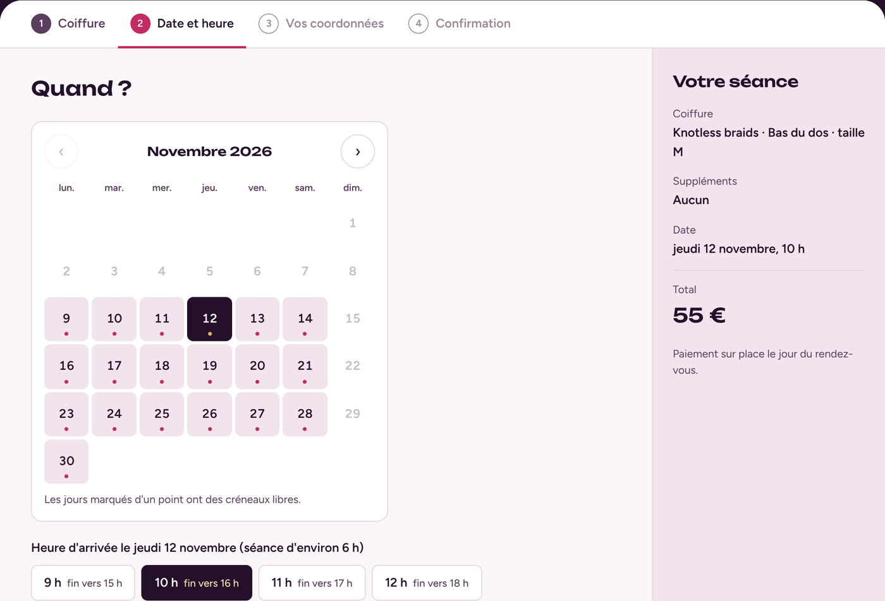
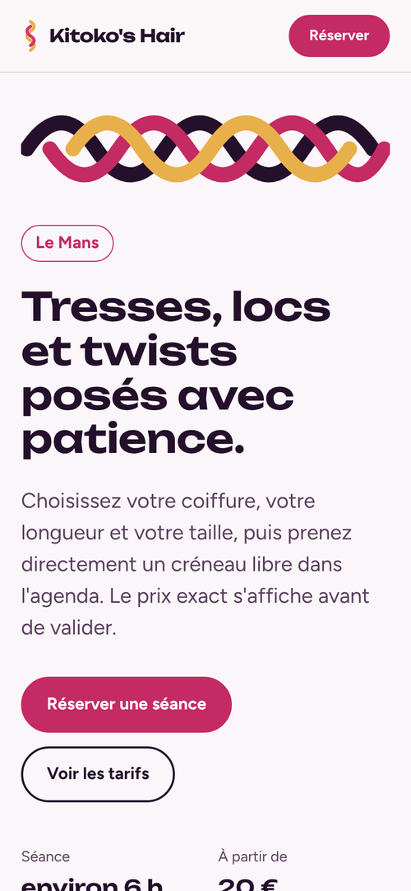

<div align="center">


# KITOKO's HAIR

**Site de réservation en ligne pour une coiffeuse spécialisée en tresses, locs et twists au Mans.**
Les clientes choisissent leur coiffure, voient le prix exact et réservent un créneau réellement libre dans le Google Agenda de la coiffeuse.

[**Voir le site**](https://dokceles.github.io/kitokos-hair/) · [Installation](#installation) · [Personnaliser](#personnaliser)


</div>

## Fonctionnalités

**Pour les clientes**
- Grille tarifaire complète par famille de coiffures (tresses, twists, locs, nattes, tissage, homme), avec les prix par longueur et par taille S, M ou L.
- Réservation en 4 étapes : coiffure → date et heure → coordonnées → confirmation.
- Prix calculé en direct : longueur, taille, suppléments (bohème, perles, shampoing…) et majoration après 17 h.
- Calendrier qui n'affiche que les créneaux **vraiment libres** dans l'agenda de la coiffeuse (une séance bloque 6 h).
- E-mail de récapitulatif avec un lien d'annulation en un clic (gratuite jusqu'à 72 h avant).
- Site rapide, adapté au téléphone, accessible au clavier et aux lecteurs d'écran.

**Pour la coiffeuse**
- Chaque demande apparaît **immédiatement dans son Google Agenda** (en jaune, « en attente »).
- Un e-mail par demande avec toutes les infos : cliente, téléphone, WhatsApp, coiffure, photo du modèle, message.
- Boutons **Confirmer** ou **Refuser** : l'événement passe en vert ✅, ou le créneau est libéré, et la cliente est prévenue automatiquement.
- Un événement ajouté à la main dans l'agenda (perso, congés, journée entière) bloque automatiquement le site.
- Acompte PayPal en option (30 % par défaut, avec retenue de 5 % en cas d'annulation tardive).

<table>
  <tr>
    <td width="70%"></td>
    <td width="30%"></td>
  </tr>
</table>

## Fonctionnement

```
 Cliente (navigateur)                 Google (compte de la coiffeuse)
┌────────────────────┐   créneaux    ┌─────────────────────────────┐
│  Site GitHub Pages │ ◀──────────── │  Apps Script (Code.gs)      │
│  index.html        │               │   ├─ lit Google Agenda      │
│  assets/js/app.js  │ ────────────▶ │   ├─ crée l'événement       │
└────────────────────┘  réservation  │   └─ envoie les e-mails     │
                                     └─────────────────────────────┘
```

- **Front-end** : HTML, CSS et JavaScript sans dépendance ni étape de build, hébergé gratuitement sur GitHub Pages.
- **Back-end** : un script Google Apps Script déployé en « application Web » sur le compte Google de la coiffeuse. Il est le seul à accéder à son agenda. Le site ne voit que des plages « occupé / libre », jamais le détail des rendez-vous.

## Installation

Compter environ 15 minutes. Le site fonctionne en **mode démo** tant que l'étape 2 n'est pas faite.

### 1. Publier le site sur GitHub Pages

1. Sur GitHub, ouvrez le dépôt, puis **Settings → Pages**.
2. Dans *Build and deployment*, choisissez **Deploy from a branch**, branche `main`, dossier `/ (root)`, puis **Save**.
3. Le site est en ligne après une minute à l'adresse `https://dokceles.github.io/kitokos-hair/`.

### 2. Connecter le Google Agenda (avec le compte Google de la coiffeuse)

1. Connecté au compte Google de la coiffeuse, allez sur [script.google.com](https://script.google.com) puis **Nouveau projet**. Nommez-le `KITOKO's HAIR – Réservations`.
2. Remplacez le contenu de `Code.gs` par celui du fichier [`apps-script/Code.gs`](apps-script/Code.gs).
3. Dans ⚙️ **Paramètres du projet**, cochez *Afficher le fichier manifeste « appsscript.json »*, puis remplacez son contenu par [`apps-script/appsscript.json`](apps-script/appsscript.json).
4. En haut de `Code.gs`, vérifiez le bloc `CONFIG` (adresse du site, horaires, e-mail).
5. Sélectionnez la fonction `setup` et cliquez sur **Exécuter**. Google demande d'autoriser l'accès à l'agenda et à l'envoi d'e-mails : acceptez. Si l'écran « Google n'a pas validé cette application » s'affiche, cliquez sur *Paramètres avancés*, puis *Accéder au projet*. C'est normal pour un script personnel.
6. Cliquez sur **Déployer → Nouveau déploiement**, type **Application Web** :
   - *Exécuter en tant que* : **Moi**
   - *Qui peut accéder* : **Tout le monde**
7. Copiez l'**URL de l'application Web** (elle se termine par `/exec`).
8. Collez-la dans [`assets/js/config.js`](assets/js/config.js) à la ligne `appsScriptUrl: ""`, puis enregistrez (commit) sur GitHub.

C'est terminé : le bandeau « mode démo » disparaît et les réservations arrivent dans l'agenda.

> **Modifier le script plus tard** : après chaque changement de `Code.gs`, faites **Déployer → Gérer les déploiements → ✏️ → Version : Nouvelle version → Déployer**. L'URL reste la même.

## Personnaliser

Tout se règle dans deux fichiers, sans toucher au reste du code :

| Fichier | Ce qu'on y change |
|---|---|
| [`assets/js/config.js`](assets/js/config.js) | Téléphone, Instagram, e-mail, URL du script, durée d'une séance, horaires d'ouverture, délai minimum, acompte PayPal |
| [`assets/js/services.js`](assets/js/services.js) | Coiffures, longueurs, prix, suppléments de taille, options |

Les prix modifiés dans `services.js` sont mis à jour à la fois dans la grille tarifaire et dans le formulaire.

**Activer l'acompte en ligne** : dans `config.js`, mettez `deposit.enabled: true` et `paypalMe: "votre-pseudo"`. Dans `Code.gs`, renseignez aussi `DEPOSIT_PAYPAL_ME`, puis redéployez.

**Changer les horaires** : modifiez `hours` dans `config.js` **et** `OPEN_HOURS` dans `Code.gs`, puis redéployez. Le script vérifie lui aussi les horaires, pour qu'on ne puisse pas les contourner.

## Structure du projet

```
kitokos-hair/
├── index.html              Page unique (accueil, tarifs, réservation, infos)
├── assets/
│   ├── css/style.css       Styles (palette, typographie, responsive)
│   ├── js/config.js        ⚙️ Réglages du salon
│   ├── js/services.js      💇🏾‍♀️ Catalogue des prestations et prix
│   ├── js/app.js           Logique : tarifs, calendrier, réservation
│   ├── fonts/              Polices Unbounded et Figtree (hébergées localement)
│   └── img/                Favicon et image de partage
├── apps-script/
│   ├── Code.gs             Back-end Google Agenda + e-mails
│   └── appsscript.json     Manifeste (fuseau Europe/Paris, autorisations)
└── docs/                   Captures d'écran du README
```

## Tester en local

```bash
python3 -m http.server 8000
# puis ouvrir http://localhost:8000
```

## Confidentialité

- Les polices sont hébergées sur le site : aucun appel à Google Fonts.
- Les données des clientes (nom, téléphone, e-mail) ne sont stockées que dans l'agenda et la boîte mail de la coiffeuse.
- Le site public ne reçoit que des plages horaires occupées, sans nom ni détail.

## Crédits

Conçu et développé par [Dave Célestin](https://github.com/Dokceles) pour KITOKO's HAIR.
Polices [Unbounded](https://fonts.google.com/specimen/Unbounded) et [Figtree](https://fonts.google.com/specimen/Figtree), sous licence SIL Open Font License.
Code sous licence [MIT](LICENSE).
